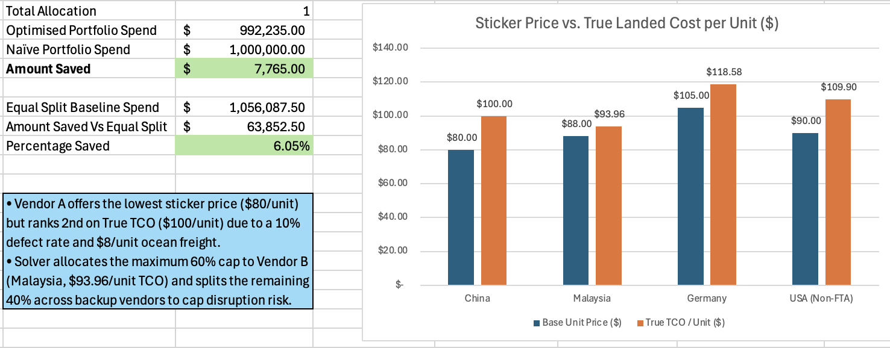

# Multi-Supplier Total Cost of Ownership (TCO) Optimizer

An Excel Solver linear optimization model designed to evaluate global supplier bids on a **true landed-cost** basis rather than sticker price alone.

### Overview & Methodology
* **Scenario:** Annual procurement tender for **10,000 industrial electric motors** across 4 global vendors (China, Malaysia, Germany, and USA).
* **True Landed Cost (TCO) Components:** Base unit price, ocean/land freight, FTA vs. non-FTA import tariffs, and expected quality/rework penalty costs (`Unit Price × Defect Rate × 1.5`).
* **Optimization Constraints:** Minimized total annual spend using **Excel Solver (Simplex LP)** subject to a **60% maximum single-supplier allocation cap** and a **10% minimum backup vendor allocation**.

### Key Results
* **Optimised Portfolio Spend:** **$992,235** (60% Malaysia, 20% China, 10% Germany, 10% USA).
* **6.0% Cost Reduction ($63,853 saved)** compared to a risk-compliant equal-split allocation ($1,056,088).
* **Outperforms Single-Sourcing ($7,765 saved)** even against buying 100% from the lowest sticker-price vendor ($80/unit base → $100/unit true TCO), while significantly reducing supply chain concentration risk.
* **Sensitivity Insight:** Shadow price / reduced cost analysis shows that relaxing the single-supplier cap by 10% yields an additional **$6,040** in annual savings.

### Files Included
* `TCO_Supplier_Optimiser.xlsx` — Full TCO calculation model, executive summary chart, and Excel Solver Sensitivity Report.

